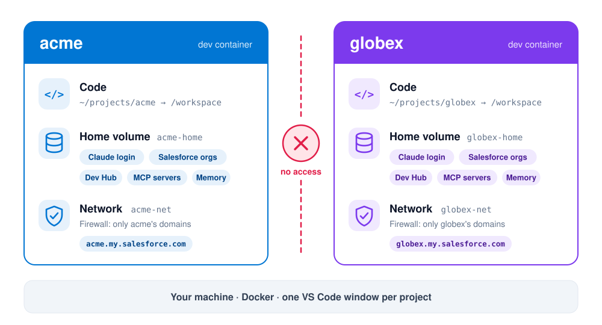
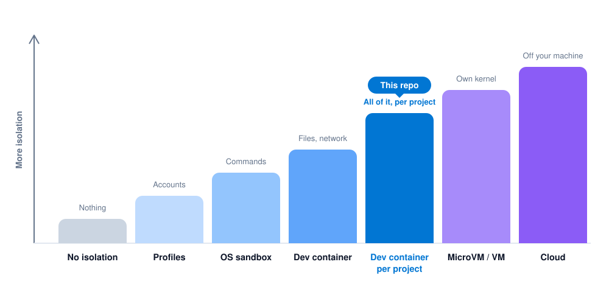

# Salesforce Dev Containers

One Claude Code dev container per Salesforce project. Each one keeps its own **Claude account, Salesforce orgs, Dev Hub, MCP servers, tools and network**. Nothing leaks between projects.

## Why

- Working on several projects means several orgs, Dev Hubs, MCP servers and Claude accounts in one environment.
- An AI agent working on one project can reach everything else on your machine.
- Isolation lets you run agents safely, start new projects clean and move a whole project to another machine.

## How it works

<picture>
  <source media="(prefers-color-scheme: dark)" srcset="docs/how-it-works-dark.svg">
  
</picture>

## Where it sits

<picture>
  <source media="(prefers-color-scheme: dark)" srcset="docs/isolation-ladder-dark.svg">
  
</picture>

| Option | What it separates | Trade-off |
| --- | --- | --- |
| No isolation | Nothing | The agent can reach every project |
| Profiles (`CLAUDE_CONFIG_DIR`) | Claude accounts | Orgs and files stay shared |
| OS sandbox (`/sandbox`) | The agent's shell commands | Orgs, MCP servers and file reads stay shared |
| Dev container (Anthropic's reference) | Files, network, accounts | Orgs reset on rebuild, one fixed domain list |
| **Dev container per project (this repo)** | **Files, network, accounts, orgs, MCP servers, memory** | **Needs Docker** |
| MicroVM / VM | Everything, with its own kernel | Heavier, less IDE friendly |
| Cloud | Everything, off your machine | Your code leaves your machine |

## Quick start

You need [Docker Desktop](https://www.docker.com/products/docker-desktop/), [VS Code](https://code.visualstudio.com/) and its [Dev Containers](https://marketplace.visualstudio.com/items?itemName=ms-vscode-remote.remote-containers) extension.

```bash
git clone https://github.com/lucianostraga/salesforce-dev-containers
cd salesforce-dev-containers
scripts/new-project.sh acme ~/projects/acme    # the folder that holds acme's repos
```

1. Add acme's orgs and tools to `~/projects/acme/.devcontainer/allowed-domains.txt`.
2. Open `~/projects/acme` in VS Code and run **Dev Containers: Reopen in Container**.
3. In the terminal, run `claude` and `/login` with acme's Claude account.
4. Connect the orgs:

   ```bash
   sf org login web --alias acme-dev
   sf org login web --set-default-dev-hub --alias acme-devhub
   ```

Another project? Run `new-project.sh` again and open it in another VS Code window.

## What each project keeps to itself

| What | Where |
| --- | --- |
| Claude login, memory and history | `acme-home` volume (`~/.claude`) |
| MCP servers | `acme-home` volume (`~/.claude.json`) |
| Salesforce orgs and Dev Hub | `acme-home` volume (`~/.sf`, `~/.sfdx`) |
| Network | `acme-net`, plus a firewall that only allows `allowed-domains.txt` |
| Code | your project folder, at `/workspace` |

The `.devcontainer` folder is read-only inside the container, so the agent can't edit its own allowed domains.

## Move a project to another machine

```bash
scripts/backup-home.sh acme                              # creates acme-home-<date>.tgz
scripts/restore-home.sh acme acme-home-<date>.tgz        # on the other machine
```

The file contains access tokens: encrypt it before moving it.

## Good to know

- **Scratch orgs** get a new domain each time. Add it to `allowed-domains.txt` and run `sudo /usr/local/bin/init-firewall.sh` inside the container.
- **Salesforce can change an org's IP addresses.** If an org stops responding, run the same command again.
- **Using another agent, like Codex?** Install it in the `Dockerfile` and add its domains to `allowed-domains.txt`.
- Tested on macOS with Docker Desktop. On Windows, use WSL 2.

<details>
<summary><b>Changes from Anthropic's reference dev container</b></summary>

Every change is marked `CHANGE:` in the files.

- One named home volume per project, instead of two volumes tied to the container ID: orgs and MCP servers survive rebuilds and the project can be moved.
- A Docker network per project, so projects can't reach each other.
- The allowed domains live in `allowed-domains.txt`, and `.devcontainer` is read-only inside the container.
- The firewall closes the network if it fails, blocks IPv6, allows DNS over TCP, can run again on a live container, and allows the Claude hosts needed for `/login`. No outbound SSH except to allowed hosts.
- Node 24 LTS, Claude Code native installer, Salesforce CLI.
- `--dns-result-order=ipv4first`, so `sf org login web` completes inside the container.

</details>

## License

[MIT](LICENSE)
